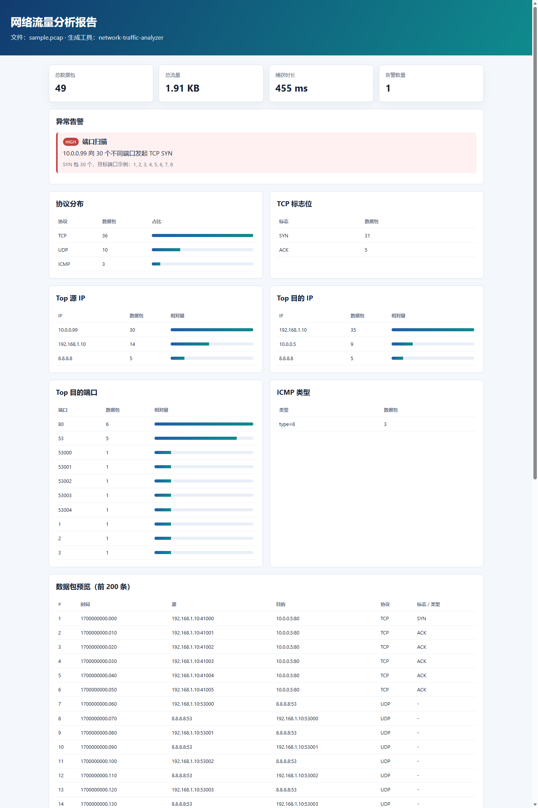

# network-traffic-analyzer

一个**纯 Python 标准库**实现的 pcap 网络流量分析与异常检测工具。项目不需要安装 Scapy、pandas、matplotlib 等第三方依赖，适合作为网络安全 / 信息通信方向的课程设计、自学项目和 GitHub 作品集项目。



## 功能

- 解析经典 `.pcap` 文件（Ethernet + IPv4 + TCP / UDP / ICMP）
- 统计总包数、总流量、捕获时长、协议分布
- 统计 Top 源 IP、Top 目的 IP、Top 目的端口、TCP 标志位、ICMP 类型
- 基于规则检测：
  - TCP SYN 端口扫描
  - ICMP 流量异常 / Ping Sweep
- 生成自包含 HTML 报告（无需联网、无外部 CSS/JS）
- 生成 CSV 摘要，便于后续分析
- 内置示例 pcap 生成器，克隆项目后无需真实流量即可运行

## 环境要求

- Python 3.8+
- 无第三方依赖

```bash
python --version
```

## 快速开始

### 1. 生成示例 pcap

```bash
python examples/make_sample_pcap.py sample.pcap
```

示例文件包含：

- 正常 HTTP 风格 TCP 流量
- DNS 风格 UDP 流量
- 少量 ICMP Echo 流量
- 一个 TCP SYN 端口扫描

### 2. 分析流量并生成报告

```bash
python run.py sample.pcap -o report.html --csv summary.csv
```

运行后会在当前目录生成：

- `report.html`：可视化 HTML 报告
- `summary.csv`：CSV 摘要

### 3. 使用自己的 pcap

```bash
python run.py capture.pcap \
  -o report.html \
  --csv summary.csv \
  --port-scan-threshold 20 \
  --icmp-flood-threshold 50
```

参数说明：

| 参数 | 默认值 | 说明 |
| --- | --- | --- |
| `pcap` | 必填 | 经典 pcap 文件路径 |
| `-o, --output` | `report.html` | HTML 报告输出路径 |
| `--csv` | 无 | 可选，CSV 摘要输出路径 |
| `--max-packets` | `200` | HTML 中展示的数据包条数 |
| `--port-scan-threshold` | `20` | 触发端口扫描告警所需的不同目的端口数 |
| `--icmp-flood-threshold` | `50` | 触发 ICMP 告警所需的数据包数 |

## 检测规则

### 端口扫描

同一源 IP 在捕获流量中向**不同目的端口**发送的 TCP SYN 包数量达到阈值时触发告警。

默认阈值：`20` 个不同端口。

### ICMP 流量异常

同一源 IP 发送的 ICMP 数据包数量达到阈值时触发告警。

默认阈值：`50` 个 ICMP 包。

> 规则保持简单透明，便于理解 TCP/IP 协议和异常流量特征。后续可以扩展 SYN Flood、DNS 隧道、ARP 欺骗等检测规则。

## 项目结构

```text
network-traffic-analyzer/
├── run.py
├── README.md
├── LICENSE
├── requirements.txt
├── pyproject.toml
├── traffic_analyzer/
│   ├── __init__.py
│   ├── __main__.py
│   ├── analyzer.py
│   ├── cli.py
│   ├── packets.py
│   ├── pcap.py
│   ├── report.py
│   └── sample.py
├── examples/
│   └── make_sample_pcap.py
├── tests/
│   └── test_analyzer.py
└── docs/
    ├── sample-report.html
    └── report-preview.png
```

## 运行测试

```bash
python -m unittest discover -s tests
```

## 实现思路

1. `pcap.py` 读取经典 pcap 全局头和逐包记录。
2. `packets.py` 按 Ethernet / IPv4 / TCP / UDP / ICMP 逐层解析。
3. `analyzer.py` 汇总流量统计并执行规则检测。
4. `report.py` 将结果渲染成 HTML/CSV。
5. `sample.py` 生成可复现的合成 pcap，方便学习和演示。

## 如何上传到 GitHub

```bash
cd network-traffic-analyzer
git init
git add .
git commit -m "Initial commit: network traffic analyzer"
git branch -M main
git remote add origin https://github.com/<your-name>/network-traffic-analyzer.git
git push -u origin main
```

建议在 GitHub 仓库页面添加 topics：

- `python`
- `network-security`
- `pcap`
- `cybersecurity`
- `traffic-analysis`
- `port-scan`

## 简历写法参考

> 基于 Python 标准库开发网络流量分析工具，实现 pcap 解析、协议统计、Top Talkers 分析和 TCP SYN 端口扫描检测，支持自动生成 HTML/CSV 报告；代码已开源至 GitHub。

## 合规声明

本项目仅用于**授权网络、公开数据集或自有实验环境**的流量分析学习。请勿用于未经授权的网络扫描、监听或攻击行为。

## License

MIT License
